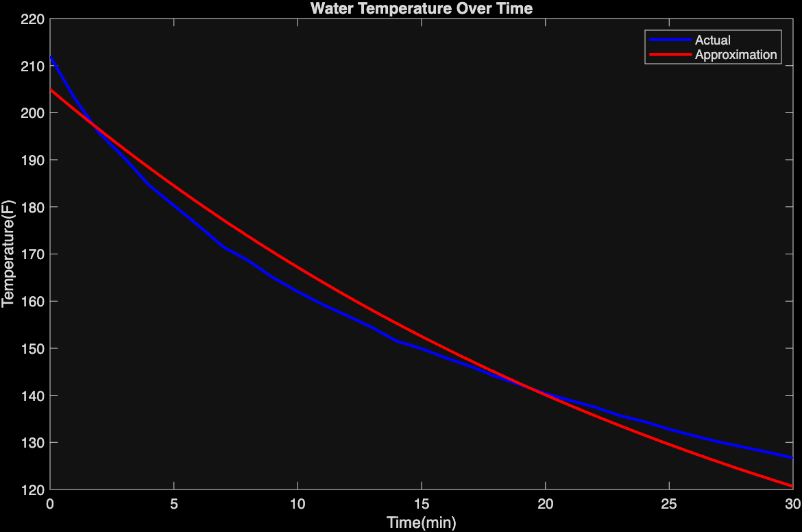
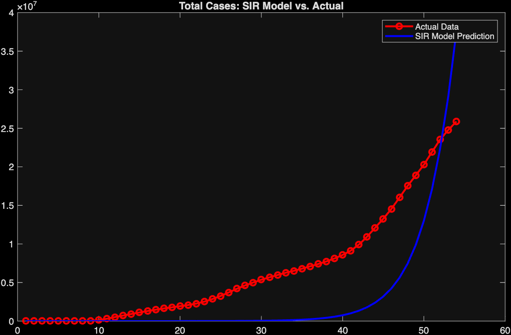
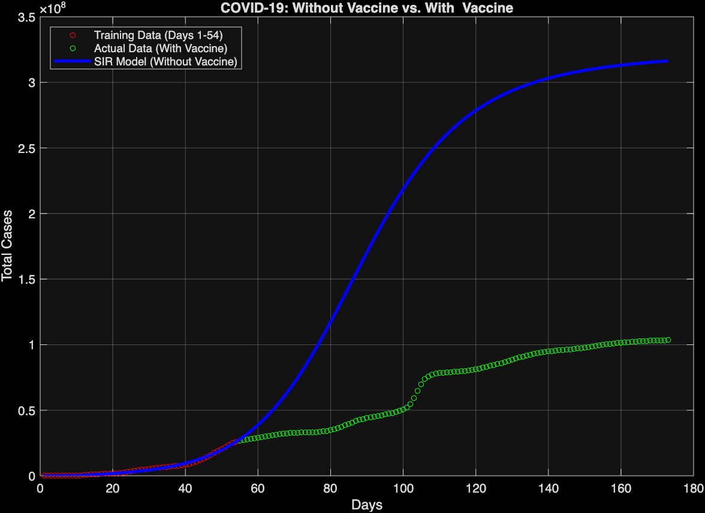

# MATLAB Modeling Portfolio
A portfolio of MATLAB computational simulations designed by Jevin Xu and Matthew Delaney.

## Project 1: Newton's Law of Cooling Model

### Overview

Estimates initial and environmental temperatures using observed data. Uses steepest descent on least squares error of temporary model to improve parameter estimates. Includes a version with gradient calculated by hand and a version with gradient directly found with 'gradient' in MATLAB. Fully designed by Jevin Xu.

### Results

*Figure 1: Fitted theoretical cooling curve against observed measurements.*

## Project 2: COVID-19 SIR Model

### Overview

Simulates COVID-19 cases in the United States had vaccines not been introduced with an SIR model. Fits a steepest descent model without beta decay to the training data, along with a separate, improved beta decay model. Plots models along with training and observed cases to estimate the number of cases vaccines prevented.

### Results

#### 1. Baseline Model (Without $\beta$-Decay)
*Optimized with Steepest Descent, constant infection rate $\beta$, designed by Jevin Xu and Matthew Delaney*

#### 2. Improved Model (With $\beta$-Decay)
*Optimized with 'fminsearch' and 'ode45', exponentially decaying infection rate $\beta$, designed by Jevin Xu*

## How to Run
1. Add scripts to repository folder & open MATLAB.
2. Run any of the `.m` scripts. Graphs and optimized parameters will output automatically.